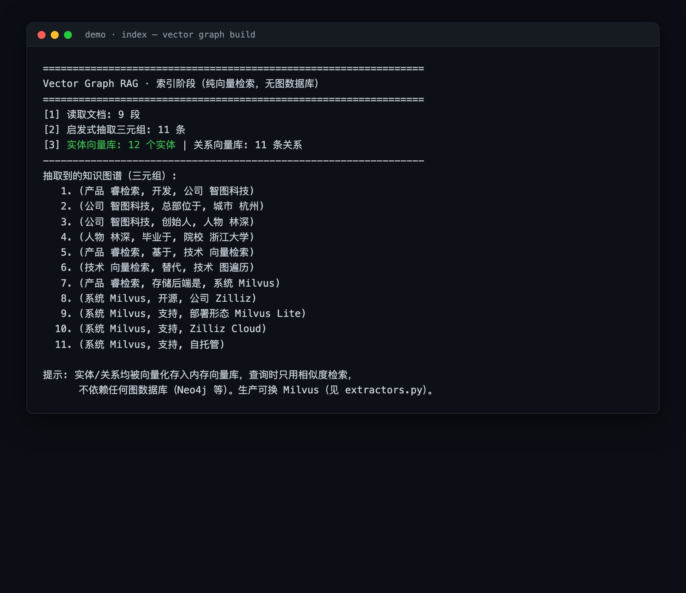
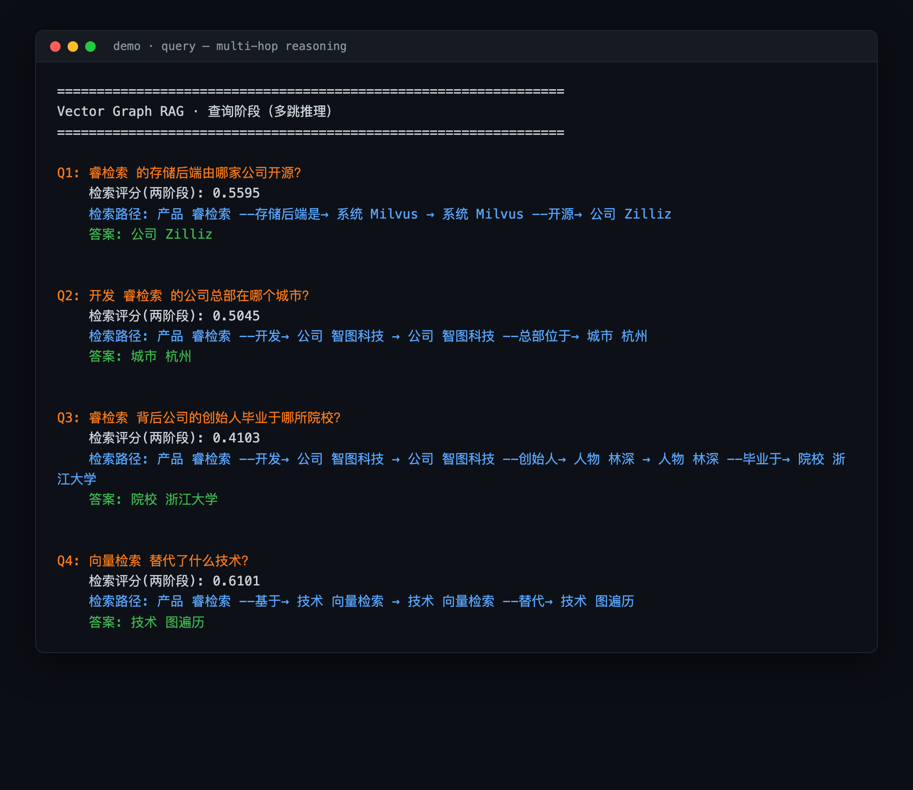

# Vector Graph RAG · 最小可运行 Demo

> 对应 Zilliz 团队开源的 **Vector Graph RAG**：用**纯向量检索**替代图数据库遍历，在 Milvus 中存储实体与关系向量，完成多跳推理问答（Multi-hop QA）。
>
> 本项目是一个**从零实现的最小可运行示例**：零硬依赖、纯标准库、**完全离线可跑**，用来把论文/官方博客里的核心思想落到能跑通的代码上。

---

## 为什么不用图数据库？

传统 Graph RAG 依赖 Neo4j 等图数据库做「实体—关系」的迭代遍历，运维重、上线慢。Vector Graph RAG 的核心创新：

| 创新点 | 说明 |
| --- | --- |
| **纯向量替代图遍历** | 实体和关系都向量化，用相似度搜索替代图数据库的迭代查询 |
| **两阶段 Jev 评分** | 关系评分 + 段落评分，达到质量—延迟的帕累托最优 |
| **单轮重排序** | 避免传统 Graph RAG 的迭代搜索循环，显著降低延迟 |

在 MuSiQue / HotpotQA / 2WikiMultiHopQA 三个多跳 QA 基准上，平均 **Recall@5 达 87.8%**，超越 Naive RAG 与 HippoRAG 2 等基线（数据为官方宣称）。

适用场景：法律、金融、医疗、学术文献等知识密集型领域，需要多跳推理、又想避免图数据库运维、快速上线的团队。

---

## 本 Demo 做了什么

把 Vector Graph RAG 的链路拆成 4 步，**不依赖任何外部服务**：

```
索引：文档 → 抽取三元组(实体,关系,对象) → 实体/关系向量化 → 存入向量库
查询：实体抽取 → 向量检索(种子实体) → 子图向量扩展(多跳) → 单轮重排序 → 生成答案
```

- **向量化**：TF-IDF（纯 Python，离线）。生产可换 `sentence-transformers`。
- **三元组抽取**：启发式规则（离线）。生产可换 LLM（见 `extractors.py`）。
- **向量库**：内存版（零依赖）。生产可换 **Milvus Lite / Zilliz Cloud / 自托管**（见 `extractors.py` 的 `MilvusVectorStore`）。
- **多跳推理**：从种子实体出发，按向量相似度做子图扩展，两阶段评分 + 单轮重排序选出最优路径。

---

## 快速开始（无需安装任何依赖）

```bash
python3 run_demo.py
```

即可看到「索引阶段」与「多跳查询阶段」的完整输出。

### 项目操作截图

**1) 索引阶段** —— 读取文档、抽取三元组、构建实体/关系向量库：



**2) 查询阶段** —— 多跳推理（1 跳 / 2 跳 / 3 跳均正确命中）：



示例问题（均基于内置示例知识图谱自动回答）：

| 问题 | 命中路径 | 答案 |
| --- | --- | --- |
| 睿检索 的存储后端由哪家公司开源？ | 睿检索 →(存储后端) 系统 Milvus →(开源) 公司 Zilliz | 公司 Zilliz |
| 开发 睿检索 的公司总部在哪个城市？ | 睿检索 →(开发) 智图科技 →(总部位于) 杭州 | 城市 杭州 |
| 睿检索 背后公司的创始人毕业于哪所院校？ | 睿检索 →(开发) 智图科技 →(创始人) 林深 →(毕业于) 浙江大学 | 院校 浙江大学 |
| 向量检索 替代了什么技术？ | 睿检索 →(基于) 向量检索 →(替代) 图遍历 | 技术 图遍历 |

---

## 文件结构

```
vector-graph-rag-demo/
├── vector_graph_rag.py   # 核心：Embedder / VectorStore / Extractor / VectorGraphRAG
├── extractors.py         # 可插拔的生产级适配器（sentence-transformers / OpenAI / Milvus）
├── run_demo.py           # 运行入口：索引 + 多跳查询，输出终端日志
├── data/
│   └── passages.txt      # 示例语料（自然语言段落，含多跳关系）
├── screenshots/          # README 用到的操作截图
├── gen_screenshots.js    # 仅用于生成本 README 的截图（需 Edge + puppeteer-core）
└── requirements.txt      # 可选依赖说明
```

---

## 换成「真·生产」组件

`extractors.py` 提供了三个可插拔适配器，按需启用（需自行 `pip install`）：

```python
from vector_graph_rag import VectorGraphRAG
from extractors import (
    SentenceTransformerEmbedder,  # pip install sentence-transformers
    OpenAIExtractor,              # pip install openai  + 设置 OPENAI_API_KEY
    OpenAIAnswerGenerator,
    MilvusVectorStore,            # pip install pymilvus
)

vg = VectorGraphRAG(
    embedder=SentenceTransformerEmbedder(),
    extractor=OpenAIExtractor(),
    answer_gen=OpenAIAnswerGenerator(),
)
```

把向量库换成 Milvus 后，即与官方 Vector Graph RAG 的存储后端一致（Milvus Lite 零配置 / Zilliz Cloud 托管 / 自托管）。

---

## 说明与免责

- 本仓库为**教学/演示用途**的最小实现，用于讲清 Vector Graph RAG 的核心思想；并非 Zilliz 官方 `zilliztech/vector-graph-rag` 的分支或复刻。
- 默认跑通路径使用 TF-IDF + 启发式抽取，**不调用任何大模型 API、无需联网**。
- 官方仓库与性能基准请以 Zilliz 官方发布为准；本文数据为官方宣称，未经独立基准验证。

---

## 相关链接

- 官方仓库：https://github.com/zilliztech/vector-graph-rag
- Zilliz / Milvus：https://milvus.io
